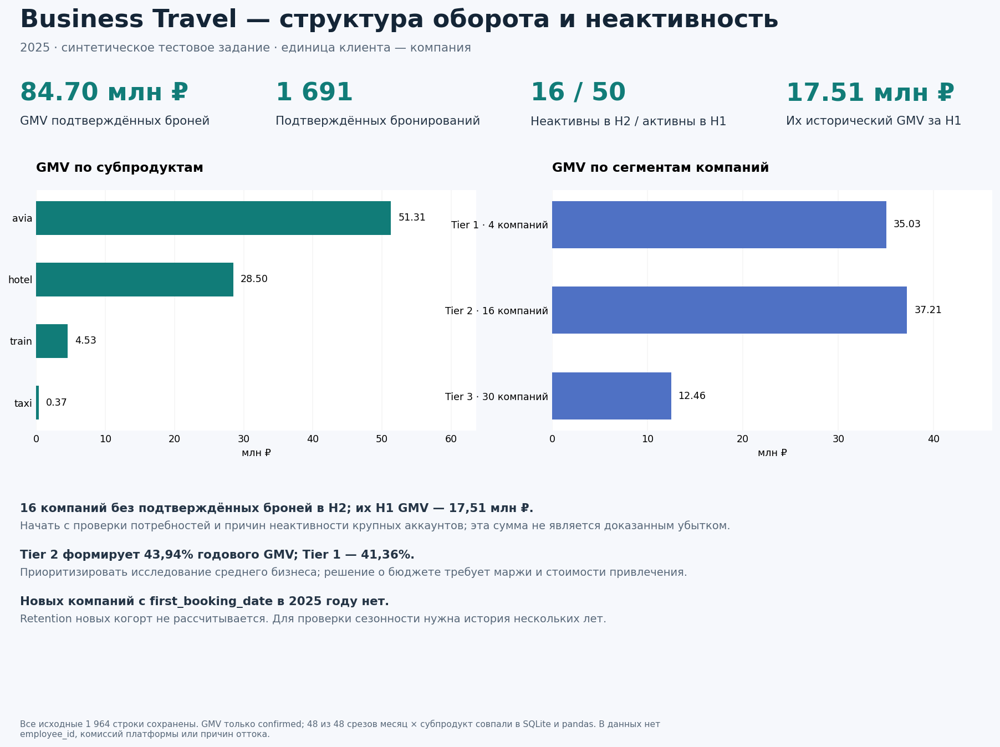

# Business Travel — продуктовая аналитика корпоративных поездок

Самостоятельный учебный кейс на **синтетических данных** за 2025 год.
Единица клиента — компания. Задача: понять структуру оборота, сравнить сегменты
и определить аккаунты для проверки неактивности.

**Начните с результата:** [выводы для бизнеса](reports/EXECUTIVE_SUMMARY.md) ·
[интерактивный HTML — скачать и открыть в браузере](https://github.com/salaticc/test_yandex/raw/refs/heads/main/docs/index.html) ·
[что исправлено](CHANGELOG.md).



## Главные результаты

| Показатель | Значение | Определение |
|---|---:|---|
| GMV 2025 | 84 702 377,92 ₽ | Сумма amount_rub по confirmed |
| Подтверждённые бронирования | 1 691 | Из 1 964 исходных записей |
| Неактивны в H2 | 16 из 50 компаний | Есть confirmed в H1, нет confirmed в H2 |
| Их исторический GMV за H1 | 17 510 111,80 ₽ | Ориентир приоритета контакта, не потерянная выручка |
| Доля Tier 2 в GMV | 43,94% | 16 компаний; частота считается на компанию |
| Сверка SQLite и pandas | 48 из 48 | Месяц × субпродукт, суммы и количество |

**Что делать дальше:** проверить причины неактивности крупных аккаунтов,
собрать данные о марже и стоимости обслуживания сегментов, расширить историю
для проверки сезонности. Эти рекомендации не выдаются за уже внедрённые решения.

## Методика

- Все исходные строки сохранены. Одновременные поездки разных сотрудников одной компании не считаются ошибкой.
- GMV включает только confirmed и только 2025 год; отмены имеют отдельный знаменатель.
- Проверяются обязательные поля, уникальность ключей, справочники и даты; JOIN — many-to-one.
- Новых компаний с first_booking_date в 2025 году нет: retention новых когорт **неприменим**, а не равен нулю.
- Годовой оборот на компанию не называется LTV, частота на компанию — частотой сотрудника.
- Один календарный год не подтверждает повторяющуюся сезонность. Причины оттока и отмен не установлены.

## Проверить расчёты

```bash
git clone https://github.com/salaticc/test_yandex.git
cd test_yandex
python -m venv .venv
# Linux/macOS: source .venv/bin/activate
# Windows PowerShell: .venv\Scripts\Activate.ps1
python -m pip install -r requirements.txt
python -m unittest discover -s tests -v
python -m scripts.build_report
```

Проверено на Python 3.12. Исходные CSV включены. Jupyter — необязательный интерфейс:
`python -m pip install -r requirements-notebook.txt`, затем открыть `analysis.ipynb`.

## Навигация

- [src/analysis.py](src/analysis.py) — расчёты и проверки данных.
- [sql/analysis.sql](sql/analysis.sql) — месячные показатели, топ компаний, отмены и неактивность.
- [analysis.ipynb](analysis.ipynb) — выполненный ноутбук со всеми заданиями.
- [reports/summary.json](reports/summary.json) — цифры, допущения и SHA256 источников.
- [reports/sql_reconciliation.csv](reports/sql_reconciliation.csv) — независимая сверка.
- [assignment.md](assignment.md) — исходная постановка.

GMV — оборот бронирований, а не выручка или прибыль сервиса. Коммерческого эффекта этого учебного проекта не заявлено.
